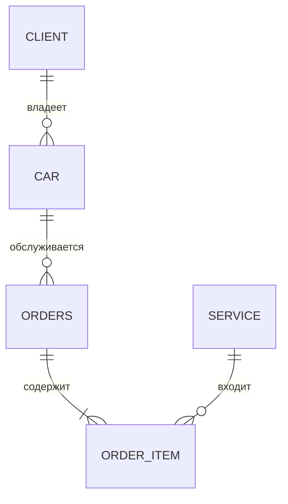

# 01. Анализ предметной области «Шиномонтаж»

Сущности:

1. **Клиент**: `client_id` (PK), ФИО, телефон, email.
2. **Автомобиль**: `car_id` (PK), госномер, марка, модель, `client_id` (FK).
3. **Заказ**: `order_id` (PK), дата, статус, итоговая сумма, `car_id` (FK).
4. **Услуга**: `service_id` (PK), название, цена, длительность.
5. **Позиция заказа**: `order_id` (PK, FK), `service_id` (PK, FK), количество, цена.

Связи: Клиент 1:N Автомобиль; Автомобиль 1:N Заказ; Заказ M:N Услуга. Последняя связь реализована таблицей «Позиция заказа», поэтому получаются две связи 1:N.

Эти сущности описывают основные процессы: кто приехал, какой автомобиль обслуживают, какие работы заказаны и сколько они стоят.
