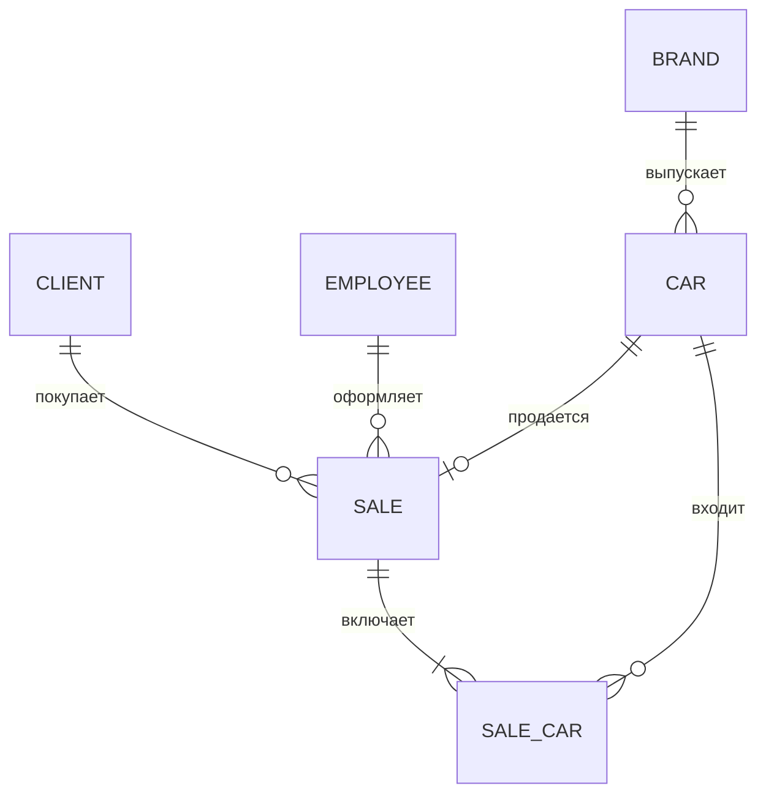
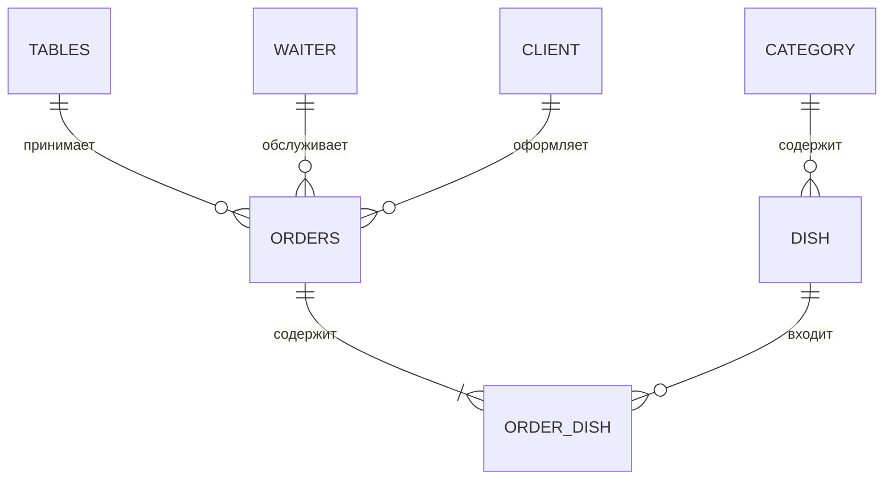

# 02. ER-диаграммы

## Автосалон

Атрибуты: Марка — `brand_id` PK, name NOT NULL, country NULL; Автомобиль — `car_id` PK, `brand_id` FK NOT NULL, VIN NOT NULL UNIQUE, model NOT NULL, year NOT NULL, price NOT NULL, color NULL; Клиент — `client_id` PK, fio NOT NULL, phone NOT NULL, email NULL; Сотрудник — `employee_id` PK, fio NOT NULL, position NOT NULL, phone NULL; Продажа — `sale_id` PK, `client_id` FK NOT NULL, `employee_id` FK NOT NULL, date NOT NULL, total NOT NULL; Состав продажи — оба FK NOT NULL и образуют PK.

Клиент 1:N Продажа: клиент может совершить несколько покупок, каждая продажа относится к одному клиенту. Если одна продажа содержит несколько машин, связь Продажа M:N Автомобиль разбивается таблицей `SALE_CAR(sale_id, car_id, sale_price)`.

## Ресторан (задание со звёздочкой)

Связь Заказ M:N Блюдо разбита таблицей `ORDER_DISH(order_id, dish_id, quantity, price)`.

**Парковка:** исходная схема противоречива. Для текущего состояния обычно Автомобиль 0..1:1 Место. Для истории парковок нужна сущность `Парковка(car_id, place_id, start_time, end_time)`, разбивающая M:N.

**Химчистка:** в «Позиции» два FK — `order_id` и `service_id`.
