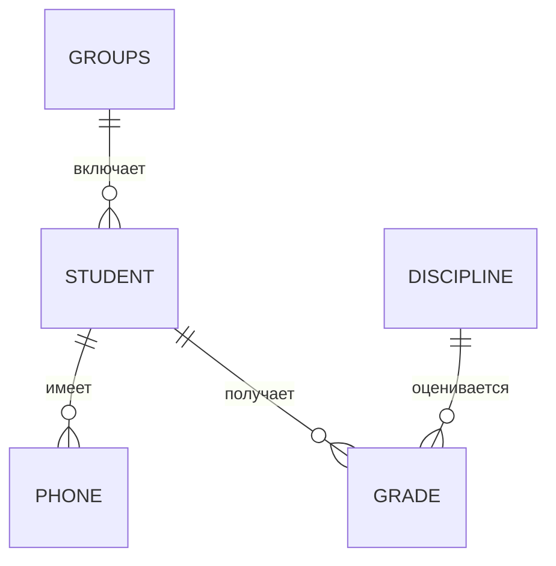

# 03. Нормализация

1. Для 1НФ создаются `Студент(id, fio)`, `Телефон(student_id, phone)` и `Студент_Дисциплина(student_id, discipline)`. Нарушение: в ячейках было несколько телефонов и дисциплин.
2. Для 2НФ: `Студент(id, fio)`, `Дисциплина(id, name)`, `Оценка(student_id, discipline_id, grade)` с составным PK. ФИО зависело лишь от `student_id`, название — лишь от `discipline_id`.
3. Для 3НФ: `Группа(id, name, faculty)` и `Студент(id, fio, group_id)`. Была транзитивная зависимость `student_id → group → faculty`.

Транзитивная зависимость: ключ определяет поле через другое неключевое поле. Пример: `employee_id → department_id → department_address`.

**Заказ:** `Клиент(client_id, name, phone)`, `Заказ(order_id, date, client_id)`, `Товар(product_id, name, price)`, `Позиция(order_id, product_id, quantity, sale_price)`. Это устраняет повторы клиента и товара.

**Сотрудник:** таблица находится в 2НФ, но не в 3НФ: `employee_id → department → manager`. Решение: `Отдел(department_id, name, manager)` и `Сотрудник(employee_id, fio, department_id)`.

**Расписание:** `Группа(group_id, name)`, `Предмет(subject_id, name)`, `Преподаватель(teacher_id, fio)`, `Аудитория(room_id, number)`, `Занятие(day, time, group_id, subject_id, teacher_id, room_id)`. PK занятия: `(day, time, group_id)`.

**BCNF:** из правила `teacher → subject` создаются `Преподаватель_Предмет(teacher, subject)` и `Назначение(student, teacher)`. В обеих таблицах каждый определитель — кандидатный ключ.

**Ошибка 1НФ:** `phone1` и `phone2` — повторяющаяся группа; телефоны следует вынести в отдельные строки таблицы телефонов.

**Книга:** после вынесения `Автор(author_id, name)` и хранения `author_id` в книге схема обычно соответствует 3НФ, если других зависимостей нет.
